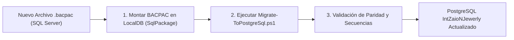

# Guía de Migración Repetible: De BACPAC (SQL Server) a PostgreSQL

Esta guía describe el procedimiento operativo estándar para migrar cualquier volcado de base de datos `.bacpac` proveniente de producción hacia la base de datos PostgreSQL `IntZaioNJewerly`.

---

## 1. Visión General del Proceso

El flujo de migración está completamente automatizado y desacoplado del código de la aplicación. Es idempotente, lo que significa que puede ejecutarse múltiples veces (por ejemplo, con nuevos volcados cada semana) sin generar duplicados ni errores de colisión de claves.



---

## 2. Herramientas Requeridas

* **SqlPackage:** Herramienta oficial de Microsoft para importar archivos `.bacpac`.
  * Ruta local habitual: `C:\Program Files\Microsoft Visual Studio\18\Community\Common7\IDE\Extensions\Microsoft\SQLDB\DAC\SqlPackage.exe`
* **LocalDB (SQL Server Express):** Servidor intermedio `(localdb)\MSSQLLocalDB`.
* **PowerShell / .NET 10 SDK:** Para ejecutar el runner de migración.

---

## 3. Procedimiento Paso a Paso

### Paso 1: Montar el nuevo `.bacpac` en LocalDB
Supongamos que recibes un nuevo archivo: `E:\repos\PomonaDb-20261105.bacpac`.

1. Abre una terminal de PowerShell.
2. Si la base temporal `PomonaDb_Source` ya existía de una ejecución anterior, elimínala:
   ```powershell
   sqlcmd -S "(localdb)\MSSQLLocalDB" -Q "IF DB_ID('PomonaDb_Source') IS NOT NULL BEGIN ALTER DATABASE PomonaDb_Source SET SINGLE_USER WITH ROLLBACK IMMEDIATE; DROP DATABASE PomonaDb_Source; END;"
   ```
3. Importa el nuevo archivo `.bacpac`:
   ```powershell
   & "C:\Program Files\Microsoft Visual Studio\18\Community\Common7\IDE\Extensions\Microsoft\SQLDB\DAC\SqlPackage.exe" `
       /Action:Import `
       /SourceFile:"E:\repos\PomonaDb-20261105.bacpac" `
       /TargetServerName:"(localdb)\MSSQLLocalDB" `
       /TargetDatabaseName:"PomonaDb_Source"
   ```

---

### Paso 2: Ejecutar el Script de Migración
El script automatizado se encuentra en: [scripts/migrations/Migrate-ToPostgreSql.ps1](file:///E:/repos/JewelrySystem/scripts/migrations/Migrate-ToPostgreSql.ps1).

Ejecuta en PowerShell:
```powershell
pwsh scripts/migrations/Migrate-ToPostgreSql.ps1 `
    -SqlServerConnectionString "Server=(localdb)\MSSQLLocalDB;Database=PomonaDb_Source;Trusted_Connection=True;TrustServerCertificate=True;" `
    -PostgreSqlConnectionString "Host=localhost;Port=5432;Database=IntZaioNJewerly;Username=postgres;Password=IntZaioN;"
```

> [!NOTE]
> Si no pasas parámetros, el script utilizará por defecto la base local `PomonaDb` hacia `IntZaioNJewerly`.

---

### Paso 3: ¿Qué realiza automáticamente el script?

1. **Limpieza Idempotente:** Trunca las tablas de negocio en cascada en PostgreSQL para garantizar que no existan colisiones de claves ni datos residuales.
2. **Transferencia en Orden Topológico:** Migra los registros respetando la integridad referencial:
   1. `IdentificationTypes`
   2. `Brands`
   3. `ItemTypes`
   4. `Persons`
   5. `Items`
   6. `Jewelry`
   7. `Watches`
   8. `DailyRecords`
   9. `AspNetUsers` (transfiere hashes de contraseñas y marcas de seguridad)
   10. `AspNetUserRoles` (asocia los roles por nombre exacto, garantizando acceso a administradores)
3. **Sincronización de Secuencias:** Ajusta el valor interno de cada secuencia (`SERIAL / IDENTITY`) al `MAX("Id")` de cada tabla.
4. **Matriz de Validación:** Imprime en consola un reporte comparativo del número de filas de origen contra destino.

---

## 4. Resultado Esperado en Consola

```text
==========================================================
  JewerlySystem Data Migrator (SQL Server -> PostgreSQL)  
==========================================================
[1/4] Preparando base de datos PostgreSQL...
  -> Tablas truncadas exitosamente para carga limpia.

[2/4] Migrando tablas...
  -> "IdentificationTypes": 3 registros transferidos.
  -> "Brands": 13 registros transferidos.
  -> "ItemTypes": 7 registros transferidos.
  -> "Persons": 92 registros transferidos.
  -> "Items": 1125 registros transferidos.
  -> "Jewelry": 801 registros transferidos.
  -> "Watches": 324 registros transferidos.
  -> "DailyRecords": 538 registros transferidos.
  -> "AspNetUsers": 2 registros transferidos.
  -> "AspNetUserRoles": 4 registros transferidos.

[3/4] Sincronizando secuencias de PostgreSQL al último ID...
  -> Secuencia de "IdentificationTypes": valor ajustado a 3
  -> Secuencia de "Brands": valor ajustado a 13
  -> Secuencia de "ItemTypes": valor ajustado a 7
  -> Secuencia de "Persons": valor ajustado a 97
  -> Secuencia de "Items": valor ajustado a 13784
  -> Secuencia de "Jewelry": valor ajustado a 4218
  -> Secuencia de "Watches": valor ajustado a 2248
  -> Secuencia de "DailyRecords": valor ajustado a 539

[4/4] Validando paridad de registros...
------------------------------------------------------------------
Tabla                |   SQL Server |   PostgreSQL | Estado    
------------------------------------------------------------------
IdentificationTypes  |            3 |            3 | CORRECTO  
Brands               |           13 |           13 | CORRECTO  
ItemTypes            |            7 |            7 | CORRECTO  
Persons              |           92 |           92 | CORRECTO  
Items                |         1125 |         1125 | CORRECTO  
Jewelry              |          801 |          801 | CORRECTO  
Watches              |          324 |          324 | CORRECTO  
DailyRecords         |          538 |          538 | CORRECTO  
AspNetUsers          |            2 |            2 | CORRECTO  
AspNetUserRoles      |            4 |            4 | CORRECTO  
------------------------------------------------------------------
¡MIGRACIÓN COMPLETADA CON ÉXITO Y PARIDAD DEL 100%!
```

---

## 5. Exportación y Entrega al Cliente

Una vez ejecutada la migración a PostgreSQL, se genera el paquete de exportación para el cliente que ha instalado PostgreSQL.

### Archivos generados en `E:\repos\PomonaDb_PostgreSQL_Export_20261102\` y `scripts/export/`:
1. **`IntZaioNJewerly_20261102.sql`**: Volcado SQL completo (tablas, datos, índices y secuencias sincronizadas).
2. **`IntZaioNJewerly_20261102_with_create_db.sql`**: Volcado SQL con instrucción `CREATE DATABASE`.
3. **`IntZaioNJewerly_20261102.dump`**: Volcado binario comprimido (`pg_dump -F c`).
4. **`Import-Database.ps1`**: Script automatizado PowerShell para el cliente.
5. **`import-database.bat`**: Script batch ejecutable con doble clic para Windows.
6. **`INSTRUCCIONES_IMPORTACION.md`**: Manual paso a paso para el técnico o cliente.

### Comando para que el cliente importe la base de datos:
En PowerShell:
```powershell
pwsh .\Import-Database.ps1 -Password "ContraseñaPostgresCliente"
```
O con doble clic en `import-database.bat`.

